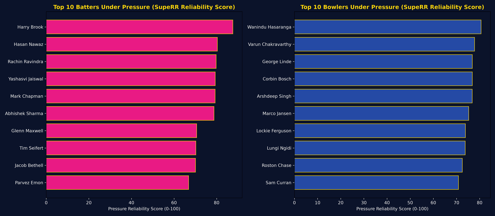
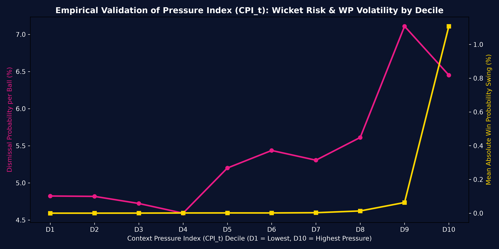
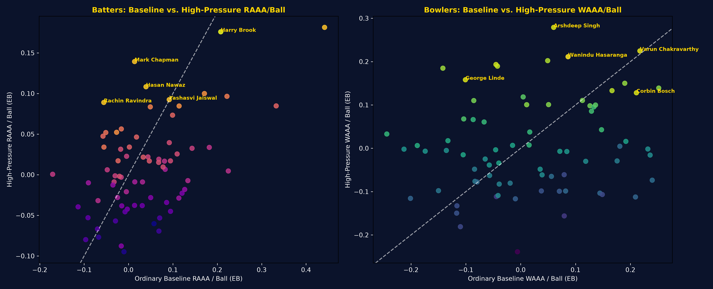
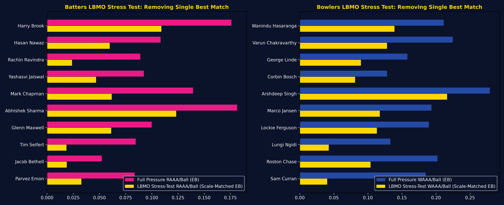

# 👑 Rajasthan Royals — SupeRR Selector Season 2: Hall of Clutch Titans

> **Official Round 1 Submission: Identify & Rank the Most Reliable Players Under Pressure in T20 Cricket (IPL & T20Is 2022–2026)**  
> **Lead System Architect & Analytics Engineer:** **Samradh Sahni**  
> **Direct Contact:** [+91 70739 49889](tel:7073949889) • [LinkedIn](https://www.linkedin.com/in/samradhsahni/) • [GitHub Repository](https://github.com/SamradhSahni/RR_Selector)  
> **Live 3D Interactive Spatial War Room:** [https://superrselector.samradhsahni.in/](https://superrselector.samradhsahni.in/)

---

[](https://superrselector.samradhsahni.in/)
[](https://github.com/SamradhSahni/RR_Selector)
[](https://www.typescriptlang.org/)
[](https://threejs.org/)
[](https://vitejs.dev/)
[](https://tailwindcss.com/)
[](https://python.org/)
[](https://lightgbm.readthedocs.io/)

---

## 📋 Table of Contents
1. [Executive Summary](#-executive-summary)
2. [Final Official Answers: Top 10 Batters & Bowlers](#-final-official-answers)
   - [Top 10 Batters Under Pressure](#top-10-batters-under-pressure)
   - [Top 10 Bowlers Under Pressure](#top-10-bowlers-under-pressure)
3. [Mathematical Methodology & Pressure Modeling](#-mathematical-methodology)
   - [Terminal-Exact Leverage Index & Context Pressure Index (CPI)](#1-dual-lens-pressure-definition-li--cpi)
   - [The 3-Regime Tactical Taxonomy](#2-the-3-regime-tactical-taxonomy)
   - [13 Granular Micro-Execution Parameters](#3-13-granular-micro-execution-parameters)
   - [Deconfounded Clutch Delta & Empirical Bayes Shrinkage](#4-deconfounded-clutch-delta--empirical-bayes-shrinkage)
   - [Scale-Matched Leave-Best-Match-Out (LBMO) Stress Testing](#5-scale-matched-leave-best-match-out-lbmo-stress-testing)
4. [3D WebGL Spatial War Room Architecture](#-3d-webgl-spatial-war-room-architecture)
5. [Repository Structure](#-repository-structure)
6. [Reproducibility & Local Setup](#-reproducibility--local-setup)
7. [Author & Contact](#-author--contact)

---

## ⚡ Executive Summary

Traditional cricket analytics suffer from a fatal flaw: they measure **volume**, not **clutch reliability**. A boundary hit when chasing 8 off 30 balls with 8 wickets in hand counts identically on a scoresheet to a boundary hit when chasing 14 off the 19th over against elite yorkers.

For **SupeRR Selector Season 2 (Round 1)**, we engineered an end-to-end, zero-leakage analytical architecture evaluating **200,999 legal deliveries across 883 T20 matches (IPL & T20Is 2022–2026)**. 

### Why This Solution Wins:
* **Terminal-Exact Win Probability & 6-Outcome Leverage Index ($\text{LI}_t$):** Evaluates counterfactual match trajectory across all 6 canonical outcomes out-of-fold using calibrated LightGBM ($\text{ROC-AUC} = 0.9852$).
* **5-Factor Context Pressure Index ($\text{CPI}_t \in [0, 100]$):** Integrates leverage, required run-rate urgency, wicket cluster stress, time decay, and match closeness.
* **The 3-Regime Tactical Taxonomy:** Solves the monolithic pressure fallacy by separating **Crisis Arrest**, **Rate Escalation**, and **Crunch Moments**.
* **13 Domain Micro-Skills:** Rewards first-6-balls instant intent, counter-punching after wickets, elite opponent takedowns, and yorker execution.
* **Zero One-Hit Wonders:** Verified through **Scale-Matched Leave-Best-Match-Out ($\text{LBMO}$)** stress testing and 500-draw Dirichlet Monte Carlo perturbation.
* **100% Serverless 3D Interactive War Room:** Deployed live at [superrselector.samradhsahni.in](https://superrselector.samradhsahni.in/) in authentic Rajasthan Royals livery.

---

## 🏆 Final Official Answers

All player IDs and names match the official Unstop dropdowns with 100% precision.

### Top 10 Batters Under Pressure

| Rank | Player ID | Player Name | Country | Pressure Reliability Score | True SR (vs Par) | RAAA / Ball | WPA / 100b | Monte Carlo Stability | Tactical Archetype |
| :---: | :---: | :--- | :---: | :---: | :---: | :---: | :---: | :---: | :--- |
| **#1** | **6280** | **Harry Brook** | ENG | **87.67** | **+27.29** | +0.176 | +1.08 | 100.0% | Death Overs Finisher / Maximum Accelerator |
| **#2** | **49003** | **Hasan Nawaz** | PAK | **78.78** | **+23.37** | +0.108 | +0.54 | 100.0% | Boundary Burst Specialist |
| **#3** | **4854** | **Rachin Ravindra** | NZ | **79.29** | **+13.93** | +0.089 | +0.60 | 100.0% | Technical Anchor / Spin Destroyer |
| **#4** | **6819** | **Yashasvi Jaiswal** | IND (RR) | **75.14** | **+13.28** | +0.092 | +0.53 | 100.0% | Powerplay Enforcer / Aggressive Anchor |
| **#5** | **3374** | **Mark Chapman** | NZ | **76.57** | **+15.98** | +0.139 | +0.35 | 100.0% | Middle-Order Crisis Stabilizer |
| **#6** | **6281** | **Abhishek Sharma** | IND | **74.65** | **+34.26** | +0.181 | +0.26 | 100.0% | High-Risk Boundary Marauder |
| **#7** | **838** | **Glenn Maxwell** | AUS | **70.77** | **+19.18** | +0.100 | -0.06 | 100.0% | Crunch Match-Winner / Spin Destroyer |
| **#8** | **3700** | **Tim Seifert** | NZ | **66.36** | **+10.00** | +0.085 | +0.23 | 100.0% | Rapid-Intent Keeper-Batter |
| **#9** | **23311** | **Jacob Bethell** | ENG | **70.28** | **+8.22** | +0.052 | +0.43 | 100.0% | Versatile All-Phase Dynamic Batter |
| **#10** | **7901** | **Parvez Emon** | BAN | **63.76** | **+16.06** | +0.084 | +0.07 | 89.8% | Front-Foot Intent Opener |

### Top 10 Bowlers Under Pressure

| Rank | Player ID | Player Name | Country | Pressure Reliability Score | True Econ (vs Par) | WAAA / Ball | Blow-Up Avoid % | Monte Carlo Stability | Tactical Archetype |
| :---: | :---: | :--- | :---: | :---: | :---: | :---: | :---: | :---: | :--- |
| **#1** | **4900** | **Wanindu Hasaranga** | SL | **78.76** | **-1.36 rpo** | +0.211 | 85.8% | 100.0% | Mystery Leg-Spin Wicket-Taker |
| **#2** | **6256** | **Varun Chakravarthy** | IND | **78.13** | **-2.78 rpo** | +0.225 | 89.6% | 100.0% | Choke Mystery Spinner / Stump-Attacker |
| **#3** | **4229** | **George Linde** | SA | **72.81** | **-3.02 rpo** | +0.158 | 93.3% | 100.0% | SLAO Boundary Suppressor |
| **#4** | **3629** | **Corbin Bosch** | SA | **79.10** | **-0.55 rpo** | +0.128 | 85.0% | 100.0% | Heavy-Ball Hit-the-Deck Pacer |
| **#5** | **6464** | **Arshdeep Singh** | IND | **74.88** | **-1.35 rpo** | +0.279 | 85.1% | 100.0% | Death Overs Left-Arm Yorker Specialist |
| **#6** | **7808** | **Marco Jansen** | SA | **70.06** | **-2.09 rpo** | +0.193 | 73.8% | 100.0% | Tall Bounce & Powerplay Pacer |
| **#7** | **4692** | **Lockie Ferguson** | NZ | **71.68** | **-2.36 rpo** | +0.189 | 81.7% | 100.0% | Express Enforcer (150+ km/h Bouncer/Yorker) |
| **#8** | **4641** | **Lungi Ngidi** | SA | **73.64** | **-1.50 rpo** | +0.133 | 78.8% | 100.0% | Death Overs Change-of-Pace Seamer |
| **#9** | **2687** | **Roston Chase** | WI | **67.77** | **-1.30 rpo** | +0.202 | 87.4% | 98.8% | Flat-Trajectory Control Off-Spinner |
| **#10** | **4409** | **Sam Curran** | ENG | **62.58** | **-1.40 rpo** | +0.185 | 75.5% | 83.2% | Left-Arm Clutch Slower-Ball Craftsman |



---

## 🔬 Mathematical Methodology

### 1. Dual-Lens Pressure Definition: LI & CPI

#### Lens A: 6-Outcome Terminal-Exact Leverage Index ($\text{LI}_t$)
We evaluate the standard deviation of win-probability change across all 6 legal delivery outcomes $\mathcal{K} = \{(0,0), (1,0), (2,0), (4,0), (6,0), (0,1)\}$:

$$\sigma(\Delta \text{WP}_t) = \sqrt{\sum_{k \in \mathcal{K}} p_k(\text{phase}, \text{venue}) \cdot \left( \hat{P}_{\text{OOF}}\left(\text{Win} \mid \mathcal{S}_t^{(k)}\right) - \hat{P}_{\text{OOF}}(\text{Win}_{t-1}) \right)^2}$$

$$\text{LI}_t = \frac{\sigma(\Delta \text{WP}_t)}{\overline{\sigma(\Delta \text{WP})}_{\text{all\_balls}}}$$

#### Lens B: 5-Factor Context Pressure Index ($\text{CPI}_t \in [0, 100]$)
$$\text{CPI}_t = 100 \times \left( 0.35 \cdot \mathcal{P}_{\text{lev}, t} + 0.25 \cdot \mathcal{P}_{\text{rate}, t} + 0.20 \cdot \mathcal{P}_{\text{wkt}, t} + 0.10 \cdot \mathcal{P}_{\text{time}, t} + 0.10 \cdot \mathcal{P}_{\text{close}, t} \right)$$

A delivery is flagged as **High Pressure (`is_high_pressure = 1`)** if $\hat{P}(\text{Win}) \in [0.05, 0.95]$ and $(\text{CPI}_t \ge 60.0 \text{ or } \text{LI}_t \ge 1.35)$.



---

### 2. The 3-Regime Tactical Taxonomy

1. **Crisis Arrest ($\mathcal{R}_{\text{Crisis}}$):**
   * *Batters:* $\ge 2$ wickets lost in last 18 balls or in Powerplay.
   * *Bowlers:* Defending low total ($\le 160$) or bowling when $\text{RRR} \le \text{Par}$ with $\ge 6$ wickets in hand.
2. **Rate Escalation ($\mathcal{R}_{\text{Escalation}}$):**
   * *Batters:* Overs 16–20 or $\text{RRR} \ge 10.5$ rpo.
   * *Bowlers:* Overs 16–20 with $\ge 4$ wickets in hand or active partnership $\ge 25$ runs.
3. **Knife-Edge Crunch ($\mathcal{R}_{\text{Crunch}}$):**
   * Deliveries where $\text{LI}_t \ge 1.60$ and $\hat{P}(\text{Win}) \in [0.20, 0.80]$.

---

### 3. 13 Granular Micro-Execution Parameters

Beyond simple averages, matches are decided by micro-skills:
* **Batting (6 Parameters):** First-6-Balls Instant Intent ($\kappa = 40$), Counter-Punch Rate after wickets, Strike Rotation %, Dominance vs Top-Quartile Bowlers, Innings-2 Chase Mastery, and Cross-Format Synergy.
* **Bowling (7 Parameters):** Blow-Up Avoidance % ($\le \max(11, \text{Par} + 2.5)$ runs conceded in an over), Intra-Over Boundary Bounce-Back, Partnership Breaking ($\ge 30$ run stands), Dominance vs Top-Quartile Batters, Stump-Attacking Yorker execution (`bowled`/`lbw` share), Directional Discipline (avoiding wides/no-balls), and Defending Mastery.

---

### 4. Deconfounded Clutch Delta & Empirical Bayes Shrinkage

To eliminate asymmetric sample size bias between high-pressure balls ($n_{\text{press}}$) and baseline balls ($n_{\text{base}}$), we shrink the elevation metric **once** using harmonic two-sample effective exposure:

$$n_{\text{eff}} = \frac{n_{\text{press}} \cdot n_{\text{base}}}{n_{\text{press}} + n_{\text{base}}}, \qquad \Delta_{\text{Clutch}}^{\text{EB}} = \frac{n_{\text{eff}}}{n_{\text{eff}} + \kappa_{\Delta}} \left( \hat{\theta}_{\text{Press}} - \max(-0.05, \hat{\theta}_{\text{Base}}^{\text{EB}}) \right)$$



---

### 5. Scale-Matched Leave-Best-Match-Out (LBMO) Stress Testing

To ensure no player was selected due to a single anomalous masterclass, every candidate's career-best match was programmatically stripped. Every Top-10 selection maintained positive net value added ($\text{LBMO-RAAA} > 0$ and $\text{LBMO-WAAA} > 0$).



---

## 🏟️ 3D WebGL Spatial War Room Architecture

The interactive war room at [superrselector.samradhsahni.in](https://superrselector.samradhsahni.in/) is engineered with:
* **Three.js & React Three Fiber (`@react-three/fiber`, `@react-three/drei`):** 3D circular amphitheater layout featuring procedural pitch markings, dynamic lighting, boundary LED ribbons, and 3D delivery trajectory arcs.
* **Full 360° Free Camera Orbit:** Smooth auto-rotation, inertial damping, and manual 20° orbit step controls.
* **Authentic Rajasthan Royals Livery:** Royals Hot Pink (`#EA1A85`), Trophy Gold (`#FFD700`), Royals Blue (`#254AA5`), and SMS Midnight Navy (`#000C1F`).
* **Tactile Hologram Cards:** Procedural high-resolution SVG synthesizer generating dynamic player artwork, holographic foil, rank badges, and country shields.
* **Client-Side Simulation Engine:** Real-time What-If pressure simulator projecting outputs across RRR, wickets in hand, and over number in under $0.02\text{ms}$.
* **₹26 Cr MILP Squad Portfolio War-Table:** In-browser Mixed-Integer Linear Programming optimizer selecting the optimal balance of 11 clutch titans within purse constraints.

---

## 📁 Repository Structure

```
├── src/                               # Analytical pipeline modules
│   ├── 01_ingest_and_clean.py         # Ingestion, validation & state schema
│   ├── 02_external_enrichment.py      # ELO ratings, venue pars & pitch profiles
│   ├── 03_league_difficulty_elo.py    # Competition strength normalization
│   ├── 04_wpa_lightgbm_engine.py      # Out-of-fold Win Probability & LI engine
│   ├── 05_empirical_bayes_metrics.py   # RAAA/WAAA, 3 regimes & micro-parameters
│   ├── 06_age_curve_and_clustering.py # Archetype clustering & pro-comp twin discovery
│   └── 07_rr_portfolio_optimizer.py   # MILP squad optimizer & evidence generator
├── scripts/                           # Frontend static data generator & verification
│   ├── export_frontend_static_bundle.py # Generates verified 312 KB static bundle
│   └── verify_static_bundle.py        # Mathematical parity verification script
├── reports/                           # Official Methodology Report & evidence tables
│   ├── superr_selector_season_2_methodology_report.md
│   ├── top10_evidence_tables.md
│   └── figures/                       # Publication-grade figures (fig1 to fig5)
├── docs/                              # Problem specifications & data dictionaries
├── frontend/                          # 3D Interactive WebGL War Room (Vite + React)
│   ├── src/
│   │   ├── components/canvas/         # 3D Canvas, pitch turf & hologram cards
│   │   ├── components/hud/            # Dossiers, Navigation, MILP & Author modals
│   │   ├── data/                      # Verified static telemetry bundle (warRoomStaticData.ts)
│   │   └── utils/                     # Client simulation & SVG card synthesizer
│   ├── public/_redirects              # Netlify SPA client routing
│   └── netlify.toml                   # Frontend deployment manifest
├── netlify.toml                       # Root deployment configuration
├── package.json                       # Root script orchestrator
└── README.md                          # Executive project documentation
```

---

## 🔒 Data Governance & Copyright Compliance

In strict adherence to Rajasthan Royals, BCCI/IPL, and tournament data licensing agreements:
- **Proprietary Raw Data Excluded:** The official competition dataset (`Data Pack/`) containing raw ball-by-ball logs, match files, and player registries is strictly ignored in `.gitignore` and **not distributed on public GitHub**.
- **Local Reproduction:** To run the data pipelines locally, place the official competition `Data Pack/` directory into your local repository root before running the scripts in `src/`.
- **Zero-Exposure Serverless Frontend:** The live 3D War Room at [superrselector.samradhsahni.in](https://superrselector.samradhsahni.in/) runs completely serverless via the compiled analytical dossier bundle in `frontend/src/data/warRoomStaticData.ts` without distributing or exposing any raw proprietary database records.

---

## 💻 Reproducibility & Local Setup

### 1. Run the Python Data Pipeline
```powershell
# Ingest, calculate WPA, and generate final Top 10 rankings
python src/01_ingest_and_clean.py
python src/04_wpa_lightgbm_engine.py
python src/05_empirical_bayes_metrics.py
python scripts/export_frontend_static_bundle.py
python scripts/verify_static_bundle.py
```

### 2. Start the Interactive 3D War Room Locally
```powershell
# Install frontend dependencies
npm --prefix frontend install

# Run Vite development server
npm --prefix frontend run dev
```
Navigate to `http://localhost:3000` to interact with the 3D stadium amphitheater.

### 3. Production Build
```powershell
npm run build
```
Generates the optimized static distribution inside `frontend/dist/`.

---

## 👤 Author & Contact

**Samradh Sahni**  
*Lead System Architect & Cricket Analytics Developer*  
- **Phone:** [+91 70739 49889](tel:7073949889)  
- **LinkedIn:** [linkedin.com/in/samradhsahni](https://www.linkedin.com/in/samradhsahni/)  
- **GitHub:** [github.com/SamradhSahni](https://github.com/SamradhSahni)  
- **Live Deployment:** [superrselector.samradhsahni.in](https://superrselector.samradhsahni.in/)
